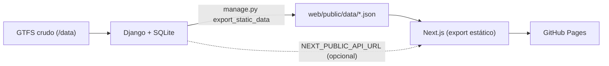
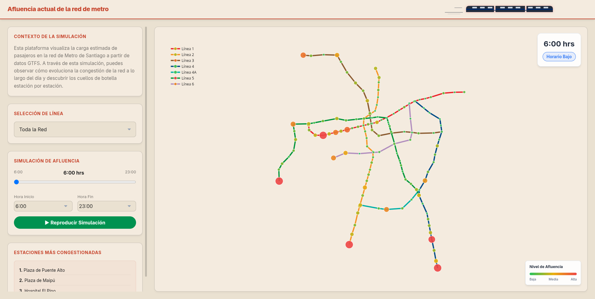

# Metro Sim 🚇


Metro Sim (**MetroVis**) es un sistema integral para la simulación, visualización y análisis de la afluencia de pasajeros en la red del Metro de Santiago.

🌐 **Demo en vivo:** https://nicorfdez.github.io/metro-sim/

> **Versión actual: 1.2.** Rediseño completo de la interfaz con tema oscuro, paleta accesible para daltónicos (Okabe-Ito), sección informativa introductoria y mapa interactivo a pantalla completa con señalética mejorada.

---

## ✨ Características (v1.2)

### Visualización
- **Mapa esquemático interactivo a pantalla completa** de las 7 líneas del Metro (L1, L2, L3, L4, L4A, L5 y L6) renderizado con Plotly sobre tema oscuro (*Slate*).
- **Paleta de colores accesible para daltónicos (Okabe-Ito / Wong)** aplicada a las líneas del mapa y a la animación de trenes.
- **Señalética de líneas y combinaciones**: insignias identificadoras en las terminales de cada línea (`L1`–`L6`) e indicadores de combinación (`🔄`) en estaciones de trasbordo.
- **Vista de línea enfocada**: al seleccionar una línea individual se encuadra automáticamente, el resto de la red se muestra como referencia tenue (*ghost lines*) y se despliegan etiquetas tipo pastilla escalonadas en 4 niveles para evitar solapamientos.
- **Codificación visual de la afluencia**: tamaño y color de cada estación (verde → amarillo → rojo) según la carga de pasajeros.
- **Escala cromática vertical flotante** (0 a 2000+ pax) con indicador dinámico y tooltip en vivo al pasar el cursor sobre una estación.
- **Leyenda interactiva sincronizada** para mostrar, ocultar o aislar líneas junto con su señalética en el mapa.

### Navegación y Simulación temporal
- **Sección informativa inicial** con tarjetas explicativas (*¿De qué trata MetroVis?*, *Escala de Afluencia* y *Dinámica Horaria*) y navegación fluida hacia el mapa.
- **Tarjeta de simulación minimalista flotante** con reproducción automática (play/pausa), slider horario (6:00 a 23:00 hrs) y selector compacto de rango de horas.
- **Clasificación horaria**: *Horario Punta*, *Horario Valle* y *Horario Bajo*, con insignia de color dinámico.

### Experiencia sonora
- **Sonificación de datos**: al pasar el cursor sobre una estación suena un tono cuya frecuencia es proporcional a su afluencia (Web Audio API).
- **Efectos de sonido** del metro: pitido y cierre de puertas al iniciar la simulación, sonido ambiente de viaje en loop, cambio de línea y clic en la leyenda.
- **Animación de trenes** en el encabezado con los colores accesibles de cada línea.

---

## 🗂️ Estructura del Proyecto

- **`/web`**: Frontend en **Next.js 16** (React 19 + TypeScript), exportado como sitio estático.
  - `web/public/data/`: datos pre-generados en JSON (estaciones, topología de líneas y afluencia por hora).
  - `web/public/sound/`: efectos de sonido.
- **`/backend`**: Backend en **Django** + Django REST Framework (`metro_api`) con base de datos SQLite. Expone la API y genera los JSON estáticos.
- **`/data`**: Datos crudos (archivos GTFS como `routes.txt`, `trips.txt`, `stop_times.txt` y `stops.txt`). No se versiona.
- **`/analisis`**: Scripts y Jupyter Notebooks para el análisis de los datos de transporte público.
- **`/hardware`**: Código fuente y esquemáticos de los componentes de hardware del simulador.
- **`/docs`**: Documentación y capturas de pantalla de la plataforma.
- **`extract_metro.py`**: Script ETL que procesa los GTFS crudos.
- **`.github/workflows/deploy.yml`**: Pipeline de despliegue automático a GitHub Pages.

### Arquitectura de datos



El frontend tiene **dos modos de datos**:

| Modo | Cuándo se usa | Fuente |
|---|---|---|
| **Estático** (por defecto) | Producción (GitHub Pages) y desarrollo sin backend | `web/public/data/*.json` |
| **API** | Si se define `NEXT_PUBLIC_API_URL` | Backend Django en vivo |

---

## 🚀 Requisitos Previos

- [Node.js](https://nodejs.org/) v20.9 o superior y npm
- [Python](https://www.python.org/) v3.10 o superior (solo para el backend o para regenerar datos)
- Git

## 🛠️ Desarrollo Local

### Opción rápida: solo frontend (usa los JSON estáticos)

```bash
cd web
npm install
npm run dev
```
*Disponible en `http://localhost:3000`.*

### Opción completa: frontend + backend Django

```bash
# 1. Backend
cd backend
source venv/bin/activate
pip install -r requirements.txt
python manage.py migrate
python manage.py runserver        # http://localhost:8000

# 2. Frontend apuntando a la API (en otra terminal)
cd web
echo "NEXT_PUBLIC_API_URL=http://localhost:8000/api" > .env.local
npm run dev
```

### Regenerar los datos estáticos

Cada vez que cambien los datos de la base de datos (nueva carga GTFS, afluencia, etc.):

```bash
cd backend
python manage.py export_static_data   # escribe en web/public/data/
```

Después haz commit de los JSON actualizados.

---

## 🌐 Despliegue en GitHub Pages

El despliegue es **automático** con GitHub Actions en cada `push` a `main`.

1. **Una sola vez:** en GitHub, ve a **Settings → Pages → Build and deployment → Source** y selecciona **GitHub Actions**.
2. Haz `git push` a `main`. El workflow [`deploy.yml`](.github/workflows/deploy.yml) compila `web/` y publica `web/out/`.
3. El sitio queda en `https://nicorfdez.github.io/metro-sim/`.

Para probar el build de producción localmente:

```bash
cd web
npm run build                       # genera web/out/ con basePath /metro-sim
mkdir -p /tmp/site && ln -sfn "$PWD/out" /tmp/site/metro-sim
python3 -m http.server -d /tmp/site 8080
# abrir http://localhost:8080/metro-sim/
```

> [!NOTE]
> El sitio se publica bajo el subpath `/metro-sim`, configurado en [`next.config.ts`](web/next.config.ts). Si se usa un dominio propio, compila con `NEXT_PUBLIC_BASE_PATH=""`. Los recursos de `/public` que se cargan manualmente (audio, JSON) deben pasar por el helper `asset()` de [`web/app/lib/paths.ts`](web/app/lib/paths.ts).

### Variables de entorno

| Variable | Dónde | Descripción |
|---|---|---|
| `NEXT_PUBLIC_API_URL` | Frontend | URL de la API Django. Si no se define, se usan los JSON estáticos. |
| `NEXT_PUBLIC_BASE_PATH` | Frontend | Subpath de despliegue. Por defecto `/metro-sim` en producción y `""` en desarrollo. |
| `DJANGO_SECRET_KEY` | Backend | Clave secreta (obligatoria si el backend se despliega). |
| `DJANGO_DEBUG` | Backend | `False` en producción. Por defecto `True`. |
| `DJANGO_ALLOWED_HOSTS` | Backend | Hosts permitidos, separados por coma. Por defecto `*`. |

---

## 📝 Scripts Disponibles en el Frontend (`/web`)

- `npm run dev`: Inicia el servidor de desarrollo.
- `npm run build`: Genera el sitio estático de producción en `web/out/`.
- `npm run lint`: Ejecuta ESLint.

## 🔬 Análisis de Datos y Hardware

- **Análisis**: los Notebooks están en `/analisis/notebooks`. Puedes iniciar Jupyter con `jupyter notebook` dentro de esa carpeta.
- **Hardware**: los detalles de conexión y el código de los microcontroladores están documentados en `/hardware`.

---

## 📜 Historial de Versiones

### v1.2: Rediseño de interfaz (MetroVis), accesibilidad y mapa a pantalla completa (actual)

- **Identidad y tema oscuro (*Slate*)**: nueva interfaz bajo el nombre **MetroVis** con fondo oscuro de alto contraste (`#0f172a` / `#1e293b`), tarjetas translúcidas (*glassmorphism*) y encabezado compacto.
- **Paleta accesible para daltónicos (Okabe-Ito / Wong)**: nuevos colores de alto contraste para las 7 líneas del Metro y la animación de trenes.
- **Sección informativa introductoria**: vista inicial con tres tarjetas explicativas (*¿De qué trata MetroVis?*, *Escala de Afluencia* y *Dinámica Horaria*) y botones de desplazamiento suave (`Explorar mapa y simulación` / `Ver información`).
- **Mapa interactivo a pantalla completa con controles flotantes**:
  - Selector de línea compacto en la parte superior central.
  - Tarjeta de simulación minimalista en la esquina inferior izquierda (botón circular play/pausa, hora actual, insignia de horario, slider y rango horario).
  - Escala cromática vertical flotante a la derecha (0 a 2000+ pasajeros) con indicador y tooltip dinámico al pasar el cursor sobre una estación.
- **Señalética y vista por línea mejorada**:
  - Insignias identificadoras (`L1`–`L6`) con flechas en las estaciones terminales principales de cada línea, sincronizadas con el clic y doble clic de la leyenda.
  - Red de referencia tenue (*ghost lines* punteadas) al inspeccionar una línea individual, con encuadre dedicado por línea (`LINE_FRAMING`) y bloqueo de zoom/arrastre para evitar solapamientos con la interfaz.
  - Etiquetas de estaciones tipo pastilla escalonadas en 4 niveles alternados e indicadores de combinación (`🔄 Comb.`) en etiquetas y tooltips.

### v1.1: Publicación en GitHub Pages



- Export estático de Next.js (`output: "export"`) con `basePath` `/metro-sim`.
- Nuevo comando `python manage.py export_static_data` que genera `stops.json`, `lines.json`, `loads.json` y `meta.json`.
- Capa de datos de doble modo (JSON estático o API Django) en `web/app/services/api.ts`.
- Helper `asset()` para que las rutas de audio y datos respeten el `basePath`.
- Archivos de sonido renombrados sin espacios (`cierre_puertas.wav`, `soft_click.mp3`).
- Workflow de GitHub Actions para el despliegue automático.
- Metadatos SEO (título y descripción) e idioma `es`.
- Plotly se carga desde el layout raíz.
- Tipado estricto en los componentes del mapa (ESLint sin errores).
- Backend: `SECRET_KEY`, `DEBUG` y `ALLOWED_HOSTS` configurables por variables de entorno; `requirements.txt` convertido a UTF-8.

### v1.0: Versión inicial
- Dashboard con mapa interactivo de afluencia por estación y hora.
- Simulación temporal con reproducción automática y clasificación horaria.
- Ranking de estaciones más congestionadas y filtro por línea.
- Sonificación de datos y efectos de sonido del metro.
- Backend Django + DRF con datos GTFS y afluencia por hora.
